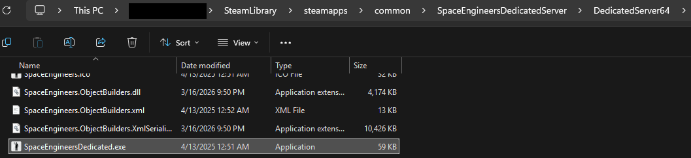
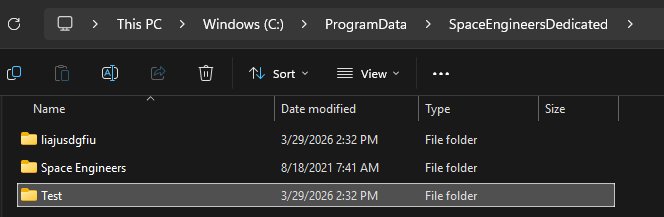
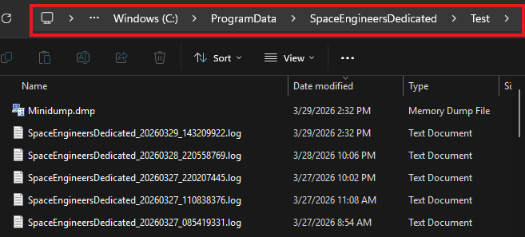
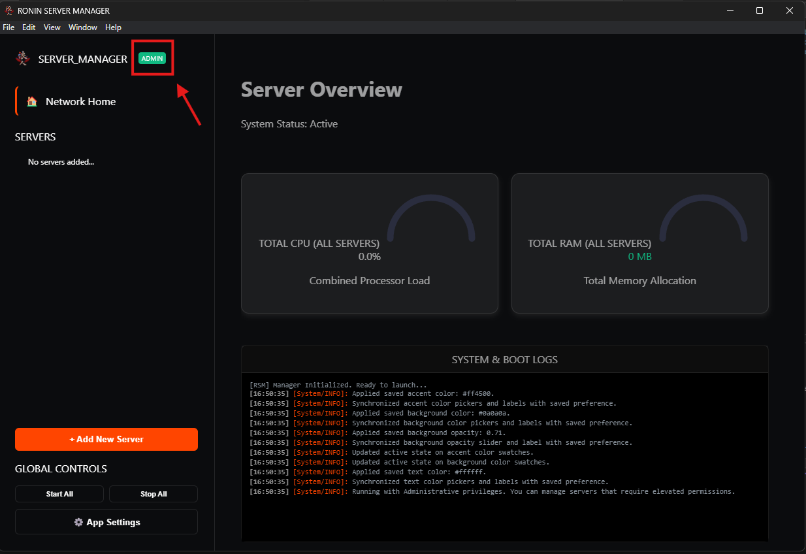
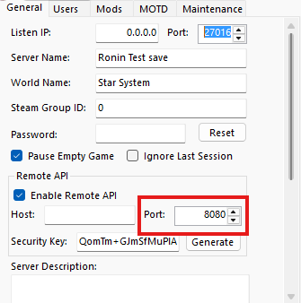
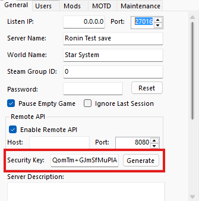
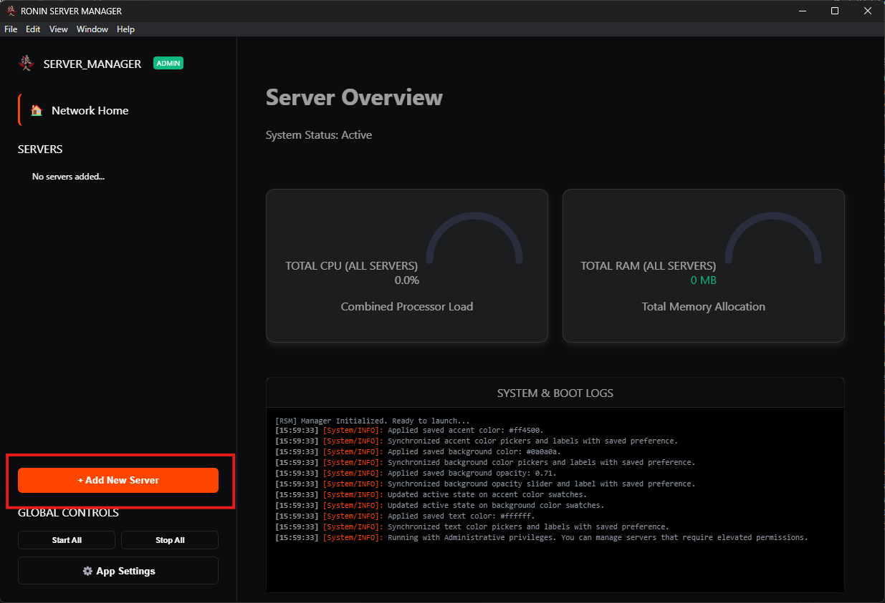
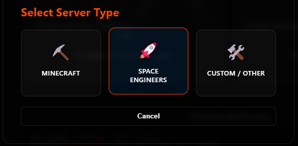
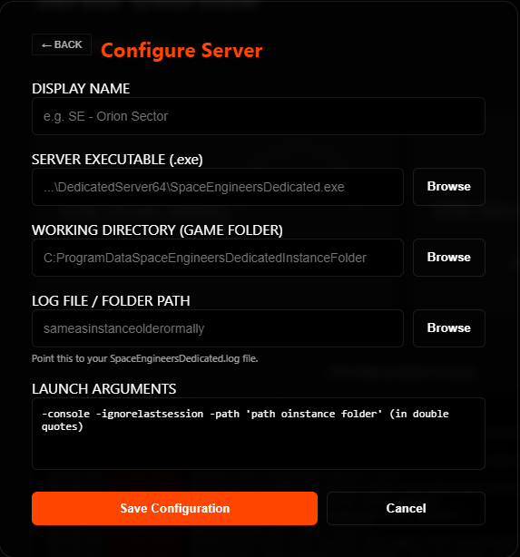

# material-rocket-launch: Space Engineers {: .rsm-header }

!!! abstract "High-Performance Integration"
    Space Engineers runs as a native Windows executable. Unlike Java-based games, RSM interacts directly with the SE binary and monitors the world state by "tailing" the physical log files in real-time. This ensures that even without a direct standard-out stream, your RSM Dashboard stays updated.

---

## ⚠️ Pre-Configuration Steps {: .rsm-header }

Before adding the server to RSM, you must perform a "Clean Boot" to stage the environment.

1.  **First Run:** Launch `SpaceEngineersDedicated.exe` manually. Configure your World Settings and run the server to ensure everything starts correctly.
2.  **Mod Sync:** After running the initial configuration, Add your mods, and start the server and wait for all mods to download. Ensure the console reaches the `Game is Ready` state.
3.  **Argument Watching:** When yoiu launch the server the last time, keep an eye on the arguments it starts with. They will be at the top of the console. We will use these arguments by default, but it is a good way to ensure they are the correct ones to use.
4.  **File Location:** Be sure you find the location of the following file locations for the server. You will need these when adding it to the RSM:

    1. __Server EXE:__ Usually located at `C:\SteamLibrary\steamapps\common\SpaceEngineersDedicatedServer\DedicatedServer64\SpaceEngineersDedicated.exe`
    2. __Instance Folder:__ Usually located at `C:\ProgramData\SpaceEngineersDedicated\InstanceFolder`
    3. __Log Folder:__ Same as instance usually, but can be different so we grab it anyway `C:\ProgramData\SpaceEngineersDedicated\InstanceFolder`
    4. __Remote API Port__ The `<RemoteApiPort>` in `SpaceEngineers-Dedicated.cfg` (default 8080). The Remote API must be enabled (`<RemoteApiEnabled>true</RemoteApiEnabled>`).
    5. __Remote Security Key__ The `<RemoteSecurityKey>` value from the same file. RSM signs every API request with it (HMAC-SHA1). If you leave the field blank, RSM reads the key from the instance's own `SpaceEngineers-Dedicated.cfg`.

---

## 📂 Required Pathing {: .rsm-header }

-   :material-file-document-edit-outline: __Executable Path__

    ---
    Points directly to the dedicated server binary.
    `...\DedicatedServer64\SpaceEngineersDedicated.exe`

    

-   :material-folder-zip: __Instance Directory__

    ---
    The folder containing your Saves and Storage.
    `C:\ProgramData\SpaceEngineersDedicated\MyInstance`

    

-   :material-text-box-search-outline: __Log Path__

    ---
    Usually the same as the Instance folder. RSM reads the latest `.log` file here to mirror the console.

    

-   :material-shield-check: __Admin Privileges__

    ---
    **Required.** SE must bind to network ports. Ensure the RSM "Admin Badge" is green before starting.

    

-   :material-import: __Server Port__

    ___
    **Required for player count and a clean stop.** RSM talks to the VRage Remote API on this port (over localhost) to read the player count and to ask the server to save and stop.

    

-   :material-export: __Server API Password__

    ___
    **Required.** This is the `<RemoteSecurityKey>` from `SpaceEngineers-Dedicated.cfg` (not an admin password). Without it the Remote API rejects RSM with a 403.

    

---

## ⚙️ Startup Arguments {: .rsm-header }

When using the Space Engineers preset in the RSM Wizard, ensure these flags are present in the **Arguments** field to ensure the server starts correctly:

| Flag | Function |
| :--- | :--- |
| `-console` | Enables the text stream RSM uses for logging. |
| `-ignorelastsession` | Automatically clears "unclean shutdown" popups. |
| `-path "..."` | Same path as to your Instance folder. |

!!! info "What RSM does through the Remote API"
    The Space Engineers Remote API has no console-command runner (the server lists its 32 routes at `/vrageremote/api`), so RSM gives the console its own small command language that maps onto the routes behind the server's admin screens. The player count and the **Stop** button use the same API -- Stop calls `DELETE /v1/server`, so the world is saved first. The API uses plain HTTP and its port is closed in the firewall by default; RSM only needs it on localhost.

    **Quick Actions:** Save World, Server Status, List Players, List Grids, Floating Objects and Commands (prints the list below).

    **Console commands** (type them in the console bar; `help` prints this list):

    | Command | What it does |
    | :--- | :--- |
    | `save`, `status`, `players` | Save the world, show server health, list connected players |
    | `grids`, `floating`, `characters`, `asteroids` | List what is in the world, with ids |
    | `delete grid\|floating\|asteroid <id>` | Remove one |
    | `clear floating` | Remove every floating object |
    | `stop grid\|floating\|character <id>` | Halt its movement |
    | `power on\|off <gridId>` | Switch a grid's power |
    | `say <message>`, `chat` | Send or read global chat |
    | `kick`, `unkick`, `ban`, `unban`, `promote`, `demote <steamId>` | Player administration |
    | `bans` | List banned players |

    Delete and clear are typed on purpose and have no one-click button. The server answers "OK" even for an id that does not exist, so RSM checks the id against the live list first and tells you when nothing matches. The server applies changes on its game thread, so a list read in the same second can still show the old state. Free-text vanilla console commands do not exist for this game; moving or teleporting grids and checking whether a grid is "floating" are not available through the Remote API, which only offers stop-movement and the list data the server returns.

---

## 
🚀 Adding to RSM

1.  **Open Manager:** Click **Add Server** and select the **Space Engineers** card.

<i>Figure 1: Clicking 'Add Server' in RSM</i>

<i>Figure 2: Selecting Space Engineers</i>

2.  **Fill Fields:** Use the paths identified above. RSM will automatically suggest common SE arguments.

<i>Figure 3: Inputing Information</i>

3.  **Save:** Click **Save Server**. The server will appear in your sidebar with the :material-rocket-launch: icon.
4.  **Launch:** Select the server and hit **Start**. RSM will begin tailing the logs immediately.

---

  <i><b>Note:</b> Because RSM reads from the physical disk log, a 1-2 second delay in console output is normal for Space Engineers.</i>

